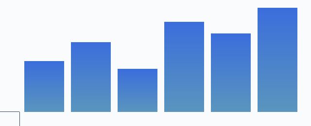

<style>
.hero { background: #eef3ff; border-left: 4px solid #2554c7; padding: 14px; }
.badge { color: #ffffff; background: #2554c7; font-size: 9pt; }
.muted { color: #64748b; }
</style>

<div align="center">

# Quarterly Product Report

<span class="muted">Q3 2026 &middot; Engineering &amp; Design</span>



</div>

<div class="hero">

**Summary.** Revenue grew <b style="color:#16a34a">18%</b> quarter over quarter while support load fell.
Inline <kbd>Ctrl</kbd>+<kbd>P</kbd>, H<sub>2</sub>O, x<sup>2</sup>, <mark>highlight</mark> and <span class="badge"> NEW </span> all work.

</div>

> [!NOTE]
> Designed mode is opt-in. Standard mode renders the same file as plain Markdown.

## 1. Overview

Lorem ipsum dolor sit amet, consectetur adipiscing elit, sed do eiusmod tempor incididunt ut labore et dolore magna aliqua. Ut enim ad minim veniam, quis nostrud exercitation ullamco laboris nisi ut aliquip ex ea commodo consequat. Duis aute irure dolor in reprehenderit in voluptate velit esse cillum dolore eu fugiat nulla pariatur.

Lorem ipsum dolor sit amet, consectetur adipiscing elit, sed do eiusmod tempor incididunt ut labore et dolore magna aliqua. Ut enim ad minim veniam, quis nostrud exercitation ullamco laboris nisi ut aliquip ex ea commodo consequat. Duis aute irure dolor in reprehenderit in voluptate velit esse cillum dolore eu fugiat nulla pariatur.


Lorem ipsum dolor sit amet, consectetur adipiscing elit, sed do eiusmod tempor incididunt ut labore et dolore magna aliqua. Ut enim ad minim veniam, quis nostrud exercitation ullamco laboris nisi ut aliquip ex ea commodo consequat. Duis aute irure dolor in reprehenderit in voluptate velit esse cillum dolore eu fugiat nulla pariatur.

> [!TIP]
> Images are kept whole: they never straddle a page break.

### 1.1 Goals

- Ship the **new onboarding** flow
  - Reduce time-to-value
  - Add guided tours
- Cut p95 latency by 30%
- [x] Migrate billing
- [ ] Retire legacy API

Lorem ipsum dolor sit amet, consectetur adipiscing elit, sed do eiusmod tempor incididunt ut labore et dolore magna aliqua. Ut enim ad minim veniam, quis nostrud exercitation ullamco laboris nisi ut aliquip ex ea commodo consequat. Duis aute irure dolor in reprehenderit in voluptate velit esse cillum dolore eu fugiat nulla pariatur.

Lorem ipsum dolor sit amet, consectetur adipiscing elit, sed do eiusmod tempor incididunt ut labore et dolore magna aliqua. Ut enim ad minim veniam, quis nostrud exercitation ullamco laboris nisi ut aliquip ex ea commodo consequat. Duis aute irure dolor in reprehenderit in voluptate velit esse cillum dolore eu fugiat nulla pariatur.

## 2. Results

| Region | Q1 | Q2 | Q3 | Change |
|:-------|---:|---:|---:|-------:|
| North America | 4.1 | 4.6 | 5.2 | +13% |
| Europe | 3.0 | 3.3 | 3.9 | +18% |
| Asia Pacific | 2.2 | 2.8 | 3.6 | +29% |
| Latin America | 0.9 | 1.1 | 1.4 | +27% |

Lorem ipsum dolor sit amet, consectetur adipiscing elit, sed do eiusmod tempor incididunt ut labore et dolore magna aliqua. Ut enim ad minim veniam, quis nostrud exercitation ullamco laboris nisi ut aliquip ex ea commodo consequat. Duis aute irure dolor in reprehenderit in voluptate velit esse cillum dolore eu fugiat nulla pariatur.

Lorem ipsum dolor sit amet, consectetur adipiscing elit, sed do eiusmod tempor incididunt ut labore et dolore magna aliqua. Ut enim ad minim veniam, quis nostrud exercitation ullamco laboris nisi ut aliquip ex ea commodo consequat. Duis aute irure dolor in reprehenderit in voluptate velit esse cillum dolore eu fugiat nulla pariatur.

> [!WARNING]
> Numbers are preliminary until the finance close on the 15th.

## 3. Detailed metrics

Lorem ipsum dolor sit amet, consectetur adipiscing elit, sed do eiusmod tempor incididunt ut labore et dolore magna aliqua. Ut enim ad minim veniam, quis nostrud exercitation ullamco laboris nisi ut aliquip ex ea commodo consequat. Duis aute irure dolor in reprehenderit in voluptate velit esse cillum dolore eu fugiat nulla pariatur.

| # | Metric | Owner | Q2 | Q3 | Notes |
|--:|:-------|:------|---:|---:|:------|
| 1 | Metric number 1 | Team B | 13 | 16 | Stable, no action needed |
| 2 | Metric number 2 | Team C | 16 | 20 | Stable, no action needed |
| 3 | Metric number 3 | Team D | 19 | 24 | Investigate regression in the long-tail cohort |
| 4 | Metric number 4 | Team E | 22 | 28 | Stable, no action needed |
| 5 | Metric number 5 | Team F | 25 | 32 | Stable, no action needed |
| 6 | Metric number 6 | Team A | 28 | 36 | Investigate regression in the long-tail cohort |
| 7 | Metric number 7 | Team B | 31 | 40 | Stable, no action needed |
| 8 | Metric number 8 | Team C | 34 | 44 | Stable, no action needed |
| 9 | Metric number 9 | Team D | 37 | 48 | Investigate regression in the long-tail cohort |
| 10 | Metric number 10 | Team E | 40 | 52 | Stable, no action needed |
| 11 | Metric number 11 | Team F | 43 | 56 | Stable, no action needed |
| 12 | Metric number 12 | Team A | 46 | 60 | Investigate regression in the long-tail cohort |
| 13 | Metric number 13 | Team B | 49 | 64 | Stable, no action needed |
| 14 | Metric number 14 | Team C | 52 | 68 | Stable, no action needed |
| 15 | Metric number 15 | Team D | 55 | 72 | Investigate regression in the long-tail cohort |
| 16 | Metric number 16 | Team E | 58 | 76 | Stable, no action needed |
| 17 | Metric number 17 | Team F | 61 | 80 | Stable, no action needed |
| 18 | Metric number 18 | Team A | 64 | 84 | Investigate regression in the long-tail cohort |
| 19 | Metric number 19 | Team B | 67 | 88 | Stable, no action needed |
| 20 | Metric number 20 | Team C | 70 | 92 | Stable, no action needed |
| 21 | Metric number 21 | Team D | 73 | 96 | Investigate regression in the long-tail cohort |
| 22 | Metric number 22 | Team E | 76 | 100 | Stable, no action needed |
| 23 | Metric number 23 | Team F | 79 | 104 | Stable, no action needed |
| 24 | Metric number 24 | Team A | 82 | 108 | Investigate regression in the long-tail cohort |
| 25 | Metric number 25 | Team B | 85 | 112 | Stable, no action needed |
| 26 | Metric number 26 | Team C | 88 | 116 | Stable, no action needed |
| 27 | Metric number 27 | Team D | 91 | 120 | Investigate regression in the long-tail cohort |
| 28 | Metric number 28 | Team E | 94 | 124 | Stable, no action needed |
| 29 | Metric number 29 | Team F | 97 | 128 | Stable, no action needed |
| 30 | Metric number 30 | Team A | 100 | 132 | Investigate regression in the long-tail cohort |
| 31 | Metric number 31 | Team B | 103 | 136 | Stable, no action needed |
| 32 | Metric number 32 | Team C | 106 | 140 | Stable, no action needed |
| 33 | Metric number 33 | Team D | 109 | 144 | Investigate regression in the long-tail cohort |
| 34 | Metric number 34 | Team E | 112 | 148 | Stable, no action needed |
| 35 | Metric number 35 | Team F | 115 | 152 | Stable, no action needed |
| 36 | Metric number 36 | Team A | 118 | 156 | Investigate regression in the long-tail cohort |
| 37 | Metric number 37 | Team B | 121 | 160 | Stable, no action needed |
| 38 | Metric number 38 | Team C | 124 | 164 | Stable, no action needed |
| 39 | Metric number 39 | Team D | 127 | 168 | Investigate regression in the long-tail cohort |
| 40 | Metric number 40 | Team E | 130 | 172 | Stable, no action needed |

Lorem ipsum dolor sit amet, consectetur adipiscing elit, sed do eiusmod tempor incididunt ut labore et dolore magna aliqua. Ut enim ad minim veniam, quis nostrud exercitation ullamco laboris nisi ut aliquip ex ea commodo consequat. Duis aute irure dolor in reprehenderit in voluptate velit esse cillum dolore eu fugiat nulla pariatur.

Lorem ipsum dolor sit amet, consectetur adipiscing elit, sed do eiusmod tempor incididunt ut labore et dolore magna aliqua. Ut enim ad minim veniam, quis nostrud exercitation ullamco laboris nisi ut aliquip ex ea commodo consequat. Duis aute irure dolor in reprehenderit in voluptate velit esse cillum dolore eu fugiat nulla pariatur.

### 3.1 Implementation

```rust
fn quarterly(revenue: &[f64]) -> f64 {
    let total: f64 = revenue.iter().sum();
    let growth = total / revenue.len() as f64;
    println!("average = {growth:.2}");
    growth
}
```

Lorem ipsum dolor sit amet, consectetur adipiscing elit, sed do eiusmod tempor incididunt ut labore et dolore magna aliqua. Ut enim ad minim veniam, quis nostrud exercitation ullamco laboris nisi ut aliquip ex ea commodo consequat. Duis aute irure dolor in reprehenderit in voluptate velit esse cillum dolore eu fugiat nulla pariatur.

Lorem ipsum dolor sit amet, consectetur adipiscing elit, sed do eiusmod tempor incididunt ut labore et dolore magna aliqua. Ut enim ad minim veniam, quis nostrud exercitation ullamco laboris nisi ut aliquip ex ea commodo consequat. Duis aute irure dolor in reprehenderit in voluptate velit esse cillum dolore eu fugiat nulla pariatur.

<!-- pagebreak -->

## 4. Appendix

<details>
<summary>Methodology</summary>

Figures are derived from the billing warehouse and reconciled monthly. Lorem ipsum dolor sit amet, consectetur adipiscing elit, sed do eiusmod tempor incididunt ut labore et dolore magna aliqua. Ut enim ad minim veniam, quis nostrud exercitation ullamco laboris nisi ut aliquip ex ea commodo consequat. Duis aute irure dolor in reprehenderit in voluptate velit esse cillum dolore eu fugiat nulla pariatur.

</details>

Transparent PNG (alpha channel):  and inline  side by side .

1. First numbered item
2. Second numbered item with a link to [Rust](https://www.rust-lang.org)
3. Third

---

Lorem ipsum dolor sit amet, consectetur adipiscing elit, sed do eiusmod tempor incididunt ut labore et dolore magna aliqua. Ut enim ad minim veniam, quis nostrud exercitation ullamco laboris nisi ut aliquip ex ea commodo consequat. Duis aute irure dolor in reprehenderit in voluptate velit esse cillum dolore eu fugiat nulla pariatur.

Lorem ipsum dolor sit amet, consectetur adipiscing elit, sed do eiusmod tempor incididunt ut labore et dolore magna aliqua. Ut enim ad minim veniam, quis nostrud exercitation ullamco laboris nisi ut aliquip ex ea commodo consequat. Duis aute irure dolor in reprehenderit in voluptate velit esse cillum dolore eu fugiat nulla pariatur.

Lorem ipsum dolor sit amet, consectetur adipiscing elit, sed do eiusmod tempor incididunt ut labore et dolore magna aliqua. Ut enim ad minim veniam, quis nostrud exercitation ullamco laboris nisi ut aliquip ex ea commodo consequat. Duis aute irure dolor in reprehenderit in voluptate velit esse cillum dolore eu fugiat nulla pariatur.
